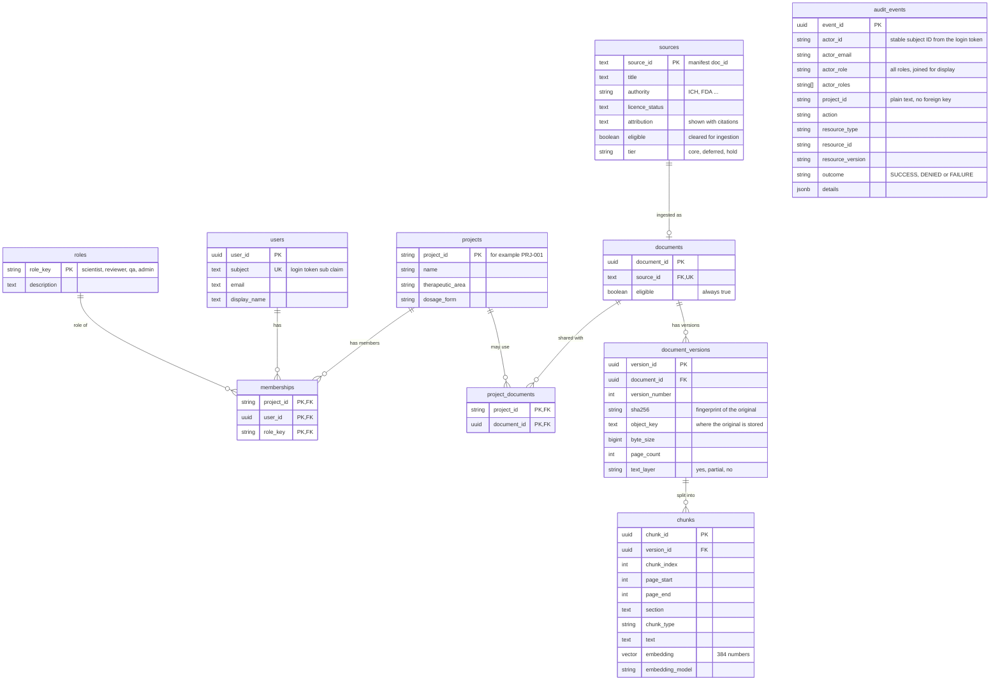

# Database schema v1 (entity-relationship diagram)

Sprint task S1-07. The migration `migrations/versions/0001_schema_v1.py` is the authoritative definition; `src/pharma_ai/infrastructure/db/models.py` mirrors it, and a test fails if the two differ.

## Diagram

## How the rules are enforced by the database itself

| Rule | Where it comes from | How the database enforces it |
|---|---|---|
| Only documents verified as reusable may be ingested | ADR-002, PRD FR-08 | `documents` points at `sources (source_id, eligible)` and has a check that `eligible` is true. A document for an ineligible source is refused, and a source cannot be made ineligible while a document from it exists. |
| Held documents can never be in the core corpus | ADR-002 | `sources` check: a source that is not eligible must have `tier = 'hold'`. |
| Every eligible source has attribution text | ADR-002 (citations show attribution) | `sources` check: eligible rows need non-empty `attribution`. |
| A stored original has a real fingerprint | PRD FR-06 | `document_versions` checks: `sha256` is 64 lowercase hex characters and is not the fingerprint of empty input (`e3b0c442...`). |
| Originals are never edited | PRD ALCOA+ "original" | A trigger refuses any change to `sha256`, `object_key` or `byte_size` of a stored version. A revision is a new version. |
| Each chunk belongs to one version, in order | S2-06 | Unique `(version_id, chunk_index)`; page range check (`page_end >= page_start`). |
| A vector always records which model made it | ADR-003 | Check: `embedding` and `embedding_model` are both set or both empty. |
| Audit records cannot be altered | PRD FR-30, NFR-07 | Triggers refuse UPDATE, DELETE and TRUNCATE on `audit_events`. |
| Audit outcomes are a fixed set | S1-11 | Check: `outcome` is SUCCESS, DENIED or FAILURE. |
| Audit records are written by the server | S1-11, ADR-005 | The API records events from the verified login token; there is no endpoint for a client to write one. |
| Retrieval is limited to the caller's projects | PRD FR-10, NFR-06 | `ChunkRepository.search_nearest` applies the project filter and the eligibility check in the same SQL statement as the vector search. No allowed projects means no results. |

## Limits to know about

- **Triggers are not full protection.** The database owner can still drop a trigger. A restricted application role (insert-only on `audit_events`) is a deployment step, not part of this migration.
- **Project access comes from the login token for now.** The `users` and `memberships` tables exist, but the API still reads project membership from token claims (S1-09/S1-10). Switching it to these tables is a separate change.
- **`chunk_type` values** (`paragraph`, `heading`, `table`, `caption`, `list`) are a proposal for the chunking work in Sprint 2.
- **The vector size (384) is fixed** by the column. A model with a different size needs a new column or a re-embedding migration.
- **Search with a strict filter:** an approximate (HNSW) index can return fewer than the requested number of results when the permission filter removes many of the nearest candidates. At this corpus size that is not a concern, but it should be re-checked when the corpus grows (UNVERIFIED for the installed pgvector version).
